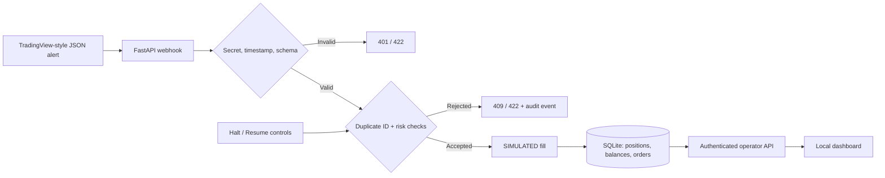

<div align="center">

# TradeBridge Pro

### Strategy signals → risk validation → observable order routing

**An open-source trading automation engineering showcase, currently running against three independent simulated broker venues.**

[](#quick-start)
[](#system-architecture)
[](#implementation-status)
[](LICENSE)

**[Source code](src/tradebridge) · [Technical case study](docs/CASE_STUDY.md) · [Risk and security boundaries](SECURITY.md) · [Discuss custom work](https://nextgentechdev.com)**

</div>

---

## Why TradeBridge Pro?

Moving from a TradingView alert to a broker order involves more than one API request. Signals may arrive late or twice, instruments differ between brokers, available funds may be insufficient, and an operator needs to inspect *why* an order was accepted or rejected.

**TradeBridge Pro is a focused demo of those engineering concerns.** It shows routing, idempotency, risk control and auditability without requiring a funded account. This is different from [TradeMesh AI](https://github.com/rajachanna/TradeMesh-AI), which explores broader portfolio infrastructure.

**Scope warning:** This project does **not** connect to Interactive Brokers, MetaTrader 5, or any crypto exchange. `SIM_IBKR`, `SIM_MT5`, and `SIM_CEX` are local **mock venues**. No real, demo-account or live account orders are placed.

## What you can examine

| Demonstrated feature | Technical value |
| --- | --- |
| TradingView-style JSON signal ingestion | An integration boundary for external strategy alerts |
| UTC timestamp freshness + field validation | Rejects malformed, expired and future-dated alerts |
| Separate webhook/operator secrets | Separates signal submission from private operational reads |
| Signal ID idempotency and conflict checks | Prevents a repeated ID from applying another simulated fill |
| Three isolated mock venue balances | Models broker-account routing without actual API calls |
| Basic risk controls | Cash, order-size, symbol exposure, aggregate exposure, position-count and realized loss limits |
| Operator halt / resume | Demonstrates an emergency stop that blocks all new simulated fills |
| SQLite orders and audit events | Allows operators to review accepted, rejected and control actions |
| Responsive dashboard | Presents simulated balances, positions, recent orders and operational status |
| API tests and GitHub Actions workflow | Repeatable verification scenarios for expected and rejected requests |

### Current mock routing matrix

| Mock destination | Supported symbols | Important limitation |
| --- | --- | --- |
| `SIM_IBKR` | `AAPL`, `MSFT` | No connection to IBKR TWS, IB Gateway or Client Portal |
| `SIM_MT5` | `EURUSD`, `XAUUSD` | No connection to MetaTrader; units are *not* MT5 lots |
| `SIM_CEX` | `BTCUSDT`, `ETHUSDT` | No crypto exchange or order-book connection |

All venues start with **fictional USD $10,000 cash each**. Fills occur immediately at the webhook's **unverified, caller-supplied price**. Fees, slippage, leverage, contract sizes, actual broker margin, partially filled orders, market prices and latency are *not* modeled. This is **not backtesting, validated P&L, or evidence of execution performance**.

## System architecture



[Architecture notes](docs/ARCHITECTURE.md) explain decisions and risk limitations in detail.

## Quick start

### Python 3.11+

```bash
git clone https://github.com/rajachanna/TradeBridge-Pro.git
cd TradeBridge-Pro
python -m venv .venv
# macOS/Linux: source .venv/bin/activate
# Windows: .venv\Scripts\activate
pip install -e ".[dev]"
cp .env.example .env
```

Edit `.env` and replace the two placeholders with **different random values (at least 16 characters; 32+ recommended)**. Do not commit them. The standalone Python server expects environment variables to be loaded explicitly:

```bash
# macOS/Linux
set -a; source .env; set +a
uvicorn tradebridge.api:app --host 127.0.0.1 --port 8000
```

Windows PowerShell: set `TB_WEBHOOK_SECRET` and `TB_OPERATOR_KEY` through environment variables before launching Uvicorn.

### Docker

```bash
cp .env.example .env
# edit .env secrets
docker compose up --build
```

The Docker setup binds port 8000 to **127.0.0.1**, with a persistent volume for mock orders.

- **Dashboard:** http://127.0.0.1:8000/
- **OpenAPI/interactive docs:** http://127.0.0.1:8000/docs
- **Health:** http://127.0.0.1:8000/health

### Demonstrate one simulated trade

Use the webhook secret configured in your local environment:

```bash
curl -X POST http://127.0.0.1:8000/api/webhook \
  -H "Content-Type: application/json" \
  -d '{
    "secret": "YOUR_WEBHOOK_SECRET",
    "signal_id": "demo-unique-0001",
    "timestamp": "2026-11-13T13:00:00+00:00",
    "venue": "SIM_CEX",
    "symbol": "BTCUSDT",
    "side": "BUY",
    "quantity": "0.01",
    "price": "65000",
    "strategy": "demo"
  }'
```

**Change `timestamp` to the current UTC time before submitting.** The demo intentionally rejects alerts older than 120 seconds or over 30 seconds into the future. This example uses fictional input prices and is not a live quote.

Expected status: `SIMULATED_FILLED`. Resubmit the same `signal_id` and order instructions for `DUPLICATE`. Change the price but reuse that ID for HTTP **409 Conflict**.

Inspect operational state:

```bash
curl -H "X-API-Key: YOUR_OPERATOR_KEY" http://127.0.0.1:8000/api/portfolio
curl -H "X-API-Key: YOUR_OPERATOR_KEY" http://127.0.0.1:8000/api/orders
curl -H "X-API-Key: YOUR_OPERATOR_KEY" http://127.0.0.1:8000/api/events
```

Operators can post to `/api/control/halt` and `/api/control/resume`, using the same `X-API-Key` header.

### TradingView setup caveat

TradingView sends a POST body containing the alert message. For a JSON payload, it uses `application/json`. **TradingView's official documentation cautions against placing sensitive credentials in webhook bodies**, and remote delivery has additional constraints. This MVP uses a shared JSON secret solely for a local demo; before exposing a production webhook, design a stronger gateway, HTTPS, network access controls and secure credential management. See [TradingView webhook documentation](https://www.tradingview.com/support/solutions/43000529348-how-to-configure-webhook-alerts/).

## Automated tests

```bash
pytest -q
```

Test cases include authentication, mock venue isolation, duplicate-ID handling, changed-payload conflicts, invalid inputs, risk rejection, manual halt and resume, daily realized-loss blocking, timestamp validation and secrets excluded from event logs.

See [tests/test_api.py](tests/test_api.py) and the [GitHub Actions workflow](.github/workflows/ci.yml). Review the Actions tab for actual execution results—**a workflow file alone is not a claim of passing CI**.

## Implementation status

| Capability | v0.1 |
| --- | --- |
| Simulated order routing to three isolated mock venues | **Implemented** |
| Risk checks, event log, operator API and dashboard | **Implemented** |
| Live market prices, broker-confirmed orders, fees/slippage | **Not implemented** |
| IBKR paper-account API adapter | Planned |
| MT5 demo-account API adapter | Planned |
| CEX testnet or sandbox order adapter | Planned |
| DEX quote/swap simulation | Planned |
| Production / live-funded trading | **Not supported** |

Official API possibilities: [IBKR paper-account API FAQ](https://www.interactivebrokers.com/support/faq/content/use-ibkrs-apis-paper-account-629299048) and [MetaTrader 5 Python integration](https://www.mql5.com/en/docs/python_metatrader5). These references are for **future work**, not proof that this repository currently integrates with them.

## Evaluation for a potential client

A serious engineering assessment should be repeatable:

1. **Understand the boundary.** Read the [architecture](docs/ARCHITECTURE.md), [security considerations](SECURITY.md) and [case study](docs/CASE_STUDY.md).
2. **Run the local demo.** Submit mock buy/sell alerts, try invalid inputs and observe the dashboard.
3. **Review the test coverage.** Check both positive and negative paths in the API tests.
4. **Scope the next milestone.** Define the real broker, demo/paper environment, instruments, order semantics, reconciliation logic, operational limits and acceptance criteria.

**For professional development inquiries:** https://nextgentechdev.com  
**Portfolio:** https://github.com/rajachanna

### About the developer

**Raja Channa — NextGen Tech Solutions**

Python automation · MetaTrader workflows · Interactive Brokers integration planning · TradingView signal processing · Crypto API systems · AI-assisted business automation

This repository demonstrates engineering approach and a functional local simulator—not broker certifications, profitability or live execution.

---

<sub>**Trading risk disclaimer:** Trading can result in substantial loss. This project is for software engineering evaluation only, not financial advice. Never use alert-supplied prices or simulated results as an investment performance claim. Do not connect v0.1 to a funded account or expose it to the internet without an independent security review.</sub>
